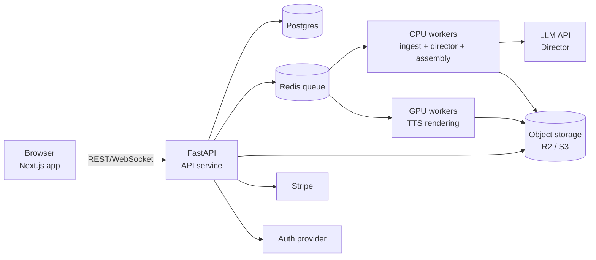

# Emo_Text → Online Audiobook Studio: Product & Engineering Plan

**Goal:** turn Emo_Text from a Tkinter desktop prototype into a hosted web app that produces
the **best-sounding, most expressive AI audiobooks**: multi-voice, emotion-directed,
chapterised, and ready to publish.

This plan supersedes Phase 3–4 of `IMPLEMENTATION_PLAN.md` for the online product. The
graduation-project code stays in the repo as the academic artifact (moved to `legacy/`).

---

## 1. Where the project is today

| Area | Current state | Gap for an online product |
|------|---------------|---------------------------|
| Input | PDF (pypdf, all pages), image OCR (easyOCR, English) | No EPUB/DOCX/TXT, no chapter detection, no cleanup of headers/footers/page numbers/hyphenation |
| Text analysis | BERT `friends-bert-base-uncased`, 7 emotions, one label per comma-split chunk, model reloaded **per chunk** | No speaker/dialogue detection, no character tracking, no emotion intensity, no context across sentences |
| Speech | gTTS (Google Translate voice), one MP3 per sentence, played immediately | Not emotional, one voice, robotic, needs internet, no file assembly |
| Voice conversion | EmoMUNIT GAN, TF 1.x, untrained | Not usable; drop from the product path |
| Output | Loose MP3s in `gtts/<emotion>/` | No merged audio, no chapters, no M4B, no loudness normalisation |
| App | Tkinter, single-threaded, Windows-only (`winsound`) | No web UI, accounts, storage, job queue, billing |
| Ops | `requirements.txt`, some pytest tests | No CI, Docker, monitoring, deployment |

**What to keep:** the core idea (emotion-aware narration), `pdf_to_text.py`, `paths.py`,
the test suite. **What to drop from the product:** gTTS, the GAN, Tkinter.

---

## 2. What "the best audiobook generator" means

Competitors (ElevenLabs Studio, Speechify, Google Play auto-narration, Apple digital
narration, Wondercraft) are good at one clean voice. The gap Emo_Text can own is the one
it was originally designed for: **performance**, not just reading.

Differentiators to build, in priority order:

1. **AI "Director" pass** — an LLM reads each chapter and produces a script: who is speaking
   each line, the emotion and intensity, pacing/pauses, whispered/shouted delivery, and
   pronunciation hints. This replaces the 7-class BERT label with context-aware direction.
2. **Full cast** — automatic character detection and voice casting (narrator + distinct
   voices per character, consistent across the whole book), user can recast any character.
3. **Expressive TTS** with real emotion control, not a label in a folder name.
4. **Line-level editor** — click any sentence to re-generate, change emotion, change voice,
   fix pronunciation; only that line is re-rendered.
5. **Publish-ready output** — M4B with chapter markers + cover, per-chapter MP3, and
   ACX/Audible-compliant mastering out of the box.
6. **Multilingual, including Arabic** — most competitors are weak on Arabic narration
   (diacritisation, dialect vs. MSA). This is a real niche to win.

---

## 3. Target architecture

| Layer | Recommendation | Why |
|-------|----------------|-----|
| Frontend | Next.js + React + Tailwind, wavesurfer.js for the editor | Rich editor UI, easy deploy (Vercel) |
| API | FastAPI + Pydantic (Python stays the main language) | Reuses existing Python code |
| Jobs | Redis + Celery (or Arq), one task per chapter / per line batch | Books take minutes–hours; must be async and resumable |
| DB | Postgres (Supabase or Neon) | Projects, chapters, lines, voices, jobs, usage |
| Storage | Cloudflare R2 (no egress fees) or S3 | Uploaded books + rendered audio |
| GPU | Serverless GPU (Modal / RunPod / Replicate) to start; dedicated GPU later | Pay per second while traffic is low |
| Auth | Clerk or Supabase Auth | Don't build auth |
| Billing | Stripe (subscriptions + character credits) | Usage-based pricing |
| Observability | Sentry + structured logs + per-job cost tracking | Know what each book costs |

### Data model (core)

`User → Project(book) → Chapter → Line(text, speaker_id, emotion, intensity, voice_id,
audio_url, status)`, plus `Character(name, voice_id)`, `Voice(provider, params, consent)`,
`Job`, `UsageEvent`. Line-level storage is what makes the editor and cheap re-renders possible.

---

## 4. The generation pipeline

1. **Ingest** — EPUB (`ebooklib`), PDF (**PyMuPDF** for layout + TOC; replace pypdf),
   DOCX (`python-docx`), TXT/Markdown, pasted text. OCR fallback for scanned PDFs
   (PaddleOCR or Tesseract; easyOCR is slow on CPU).
2. **Clean & structure** — strip running headers/footers/page numbers, join hyphenated
   line breaks, detect chapters (TOC → headings → heuristics), normalise numbers, dates,
   abbreviations, and currency into speakable text.
3. **Direct (LLM)** — per chapter, ask an LLM for structured JSON:
   `[{text, speaker, emotion, intensity 0–1, delivery, pause_after_ms}]` plus a running
   character list. Keep the existing BERT classifier as a cheap fallback / "Basic" tier.
   Model choice: a fast model (e.g. Claude Haiku 5.5) for bulk direction, a stronger one
   (Sonnet 5.5) for character analysis on the first chapters.
4. **Cast** — map each character to a voice (by gender/age/role hints from the Director),
   user can override; voices persist for the whole book.
5. **Render (TTS)** — batch lines to GPU workers with emotion/intensity conditioning;
   cache by hash(text, voice, emotion, model version) so edits only re-render changed lines.
6. **Assemble & master** — concatenate with Director pauses, room tone, loudness
   normalisation and limiting (ffmpeg `loudnorm`), export per-chapter MP3 + M4B with
   chapters and cover art.
7. **QA** — automatic ASR check (Whisper) comparing rendered audio to the source text to
   catch skipped/garbled lines, then flag them in the editor.

### TTS engine options (verify licences before launch)

| Engine | Strength | Notes |
|--------|----------|-------|
| ElevenLabs API | Top quality, many languages incl. Arabic | Expensive at book scale; good "Premium" tier, no GPU ops |
| OpenAI `gpt-4o-mini-tts` | Steerable by text instructions ("sad, quiet") | Cheap, maps directly onto Director output |
| Chatterbox (Resemble) | Open, emotion-exaggeration control, voice cloning | Strong self-hosted default |
| IndexTTS2 / Orpheus / Fish-Speech (OpenAudio) | Emotion tags/control, cloning | Self-hosted; check commercial licence terms |
| Kokoro-82M | Very fast, tiny, Apache-2.0 | Cheap "Basic"/preview tier, limited emotion |

Put every engine behind one `TTSProvider` interface (Phase 3.1 of the existing plan), start
with **one hosted API + one self-hosted model**, and pick by blind listening tests.

---

## 5. Product features by release

### MVP (public beta)
- Sign up, upload EPUB/PDF/TXT, auto chapters, preview first 2 minutes free
- Director pass + narrator voice with emotion; up to 3 character voices
- Per-chapter progress, download MP3 + M4B
- Credits-based billing, simple pricing page, landing page with real samples

### v1
- Line-level editor (re-render, change emotion/voice, pronunciation dictionary)
- Full cast with recasting; voice library with previews
- Arabic + 2–3 more languages
- ACX-compliant mastering preset; share link / embedded player

### v2
- Voice cloning **with consent verification** (user reads a generated consent phrase)
- Background music / ambience beds, sound-effect cues from the Director
- Team workspaces, API access for publishers, bulk catalogue conversion
- Mobile listening app or PWA with sync

---

## 6. Trust, safety, and legal (required before launch)

- **Copyright:** users must confirm they own or are licensed to narrate the text; Terms of
  Service + DMCA process; block known public-catalogue hashes only if abuse appears.
- **Voice cloning:** consent recording required, no celebrity/third-party voices, audio
  watermarking (e.g. AudioSeal) on all output, abuse reporting.
- **Model licences:** confirm commercial use for every TTS/OCR model and voice dataset.
- **Disclosure:** label output as AI-narrated (Audible/ACX and Google Play require this).
- **Privacy:** uploaded books are private, encrypted at rest, deletable; GDPR-style
  data-deletion flow; privacy policy.

---

## 7. Engineering roadmap

| Phase | Weeks | Deliverables | Exit criteria |
|-------|-------|--------------|---------------|
| **0. Restructure** | 1 | Move prototype to `legacy/`; new `backend/` (FastAPI) and `web/` (Next.js); pyproject, ruff, pytest, GitHub Actions CI; Docker Compose (api, worker, redis, postgres) | `docker compose up` runs API + worker; CI green |
| **1. Pipeline core** | 2–4 | Ingest (EPUB/PDF/TXT) + cleaner + chapteriser; `TTSProvider` with one hosted engine; ffmpeg assembly to MP3/M4B; CLI `emotext build book.epub` | A 50k-word EPUB becomes a chaptered M4B end-to-end |
| **2. Director** | 4–6 | LLM direction to JSON schema, character list, voice casting, render cache; BERT fallback; eval set of 20 annotated chapters | Speaker attribution ≥ 90% on eval set; blind listening prefers it over flat narration |
| **3. Web MVP** | 6–9 | Auth, upload, project page, job progress via WebSocket, audio player, downloads; storage on R2; Stripe credits | 5 external beta users finish a book without help |
| **4. Self-hosted TTS + cost** | 9–11 | GPU worker with an open expressive model, batching, autoscaling; per-book cost dashboard | Cost per finished hour of audio known and under target margin |
| **5. Editor & quality** | 11–14 | Line editor, pronunciation dictionary, Whisper QA, mastering presets | ≤ 1 flagged error per chapter on test books |
| **6. Launch** | 14–16 | Legal pages, watermarking, rate limits, Sentry, backups, landing page + samples, Product Hunt / creator outreach | Public launch |
| **7. Growth** | 16+ | Arabic, cloning with consent, publisher API, team plans | — |

### First sprint — done (see `backend/README.md`)
- [x] `backend/` with FastAPI (`/health`, inspect, jobs, downloads), Celery worker, Docker Compose
      (api + worker + redis; Postgres deferred to Phase 3 with accounts).
- [x] PyMuPDF PDF ingest (TOC chapters, header/footer/page-number removal), EPUB, TXT/Markdown.
- [x] `TTSProvider` interface with OpenAI (emotion via instructions), gTTS and an offline test
      engine; line cache; ffmpeg assembly to ACX-style chapter MP3s and a chaptered M4B.
- [x] `emotext inspect` / `emotext build` CLI; a two-chapter sample in `samples/` renders end to end.
- [x] GitHub Actions: backend tests + ruff (3.11/3.12), legacy tests, Docker image build.
- [x] Untracked the personal CV files (`1.pdf`, `1.txt`), `__pycache__`, `.idea`, test logs.
      They remain in git history; rewrite history if they must disappear from GitHub entirely.
- [ ] Not done yet: moving the prototype into `legacy/`; Compose stack not yet run locally.

---

## 8. Business model & metrics

- **Pricing:** free preview → credits per finished audio hour, tiered by voice quality
  (Basic open-model / Premium hosted voices / Cast mode). Set prices after Phase 4 measures
  real cost per hour; target ≥ 70% gross margin.
- **Customers:** indie/self-published authors (ACX-ready output), educators and course
  creators, small publishers converting backlists, Arabic-language publishers.
- **Metrics:** books completed per signup, % lines re-rendered in editor (lower = better
  direction), listening-test preference vs. competitors, cost per audio hour, paid conversion.

---

## 9. Immediate risks

| Risk | Mitigation |
|------|-----------|
| GPU/TTS cost per book too high | Start on hosted APIs with credits pricing; cache renders; Kokoro for previews |
| Director mis-attributes speakers | Show speaker per line in editor; eval set; user corrections feed prompts |
| Long-form voice drift | Fixed reference audio per voice; render per line with same seed/settings |
| Copyright abuse | Rights attestation, rate limits, takedown process |
| Open-model licence restrictions | Licence review gate before any model goes to production |
