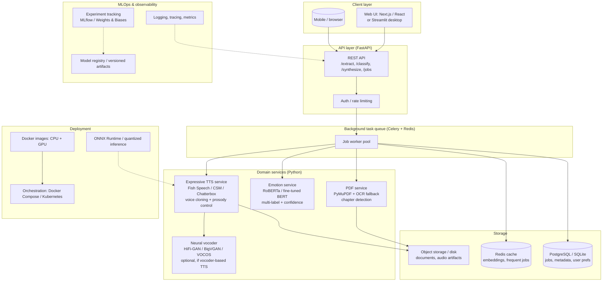

# Emo_Text — Modern Architecture (Target State)

This document proposes a production-grade architecture for Emo_Text. It preserves the original graduation-project identity (PDF → emotion → expressive audio) while separating concerns into replaceable components. The current prototype is documented in `CODE_REVIEW.md`; this is the target end state after the roadmap in `MODERNIZATION_ROADMAP.md`.

## Current architecture (verified)

```
PDF/Image/Typed text  →  pdf_to_text / ocr  →  text
text  →  script.py (BERT, HF Hub)  →  emotion label
emotion + text  →  generate_audio.py (gTTS)  →  MP3 playback
```

Problems: monolithic scripts, hardcoded paths, no entry point, GAN (`test_surprise.py`/`ops.py`/`utils.py`) exists but is untrained, unintegrated, and incompatible with TensorFlow 2.x; gTTS ignores emotion.

## Target architecture (Mermaid)



## Data flow (modern)

1. **Ingest:** User uploads a PDF or image, or types text through the web UI.
2. **Extract:** PDF service extracts text page-by-page with layout/chapter awareness (PyMuPDF); OCR fallback for scanned pages (easyOCR/Tesseract). Text is cleaned and sentence-segmented.
3. **Classify:** Emotion service runs the text through a fine-tuned transformer (RoBERTa/BERT) and returns emotion labels with confidence scores.
4. **Synthesize:** Expressive TTS service generates speech conditioned on the text + emotion + optional speaker reference (voice cloning). A neural vocoder (HiFi-GAN/BigVGAN/VOCOS) converts spectrograms to waveform if the chosen TTS is spectrogram-based.
5. **Deliver:** Audio artifacts are stored and streamed back; the UI plays them without blocking (async job polling via FastAPI + Celery).
6. **Observe:** Training runs are tracked (MLflow/W&B); production metrics and traces are logged.

## Component boundaries

| Component | Responsibility | Technology (see TECH_STACK.md) |
|-----------|---------------|------------------------------|
| Web UI | User interaction, file upload, playback | Next.js/React or Streamlit |
| FastAPI API | Request validation, job orchestration | FastAPI, Pydantic |
| Celery + Redis | Async background jobs | Celery, Redis |
| PDF service | Extraction, OCR, chapter detection | PyMuPDF, pypdf, easyOCR |
| Emotion service | Emotion classification | transformers, torch, sentence-transformers |
| TTS service | Emotional speech synthesis | Fish Speech / CSM / Chatterbox / EmoVoice |
| Vocoder | Waveform generation (optional) | HiFi-GAN, BigVGAN, VOCOS |
| Storage | Documents, audio, metadata | S3-compatible / local disk, PostgreSQL/SQLite |
| MLOps | Experiment tracking, model registry | MLflow or Weights & Biases |
| Deployment | Containerized, GPU/CPU variants | Docker, Docker Compose, ONNX Runtime |

## What is preserved from the original project

- The **PDF → text → emotion → audio** pipeline concept.
- The **7-emotion label set** (neutral, joy, sadness, fear, anger, surprise, disgust) as a starting taxonomy.
- The **academic GAN experiment** (EmoMUNIT, WORLD vocoder) remains a research artifact in `test_surprise.py`/`ops.py`/`utils.py`; it is not part of the production target path unless migrated (roadmap B2).
- Tkinter GUI remains available as a legacy local desktop option; the modern target is a web/Streamlit UI.

## Deployment models

- **Single-user desktop:** Streamlit UI + local FastAPI + CPU inference (Docker Compose, one command).
- **Multi-user server:** Next.js UI + FastAPI + Celery workers + GPU inference service + object storage.
- **Edge/CPU-only:** ONNX Runtime-quantized BERT and TTS models for CPU deployment.
